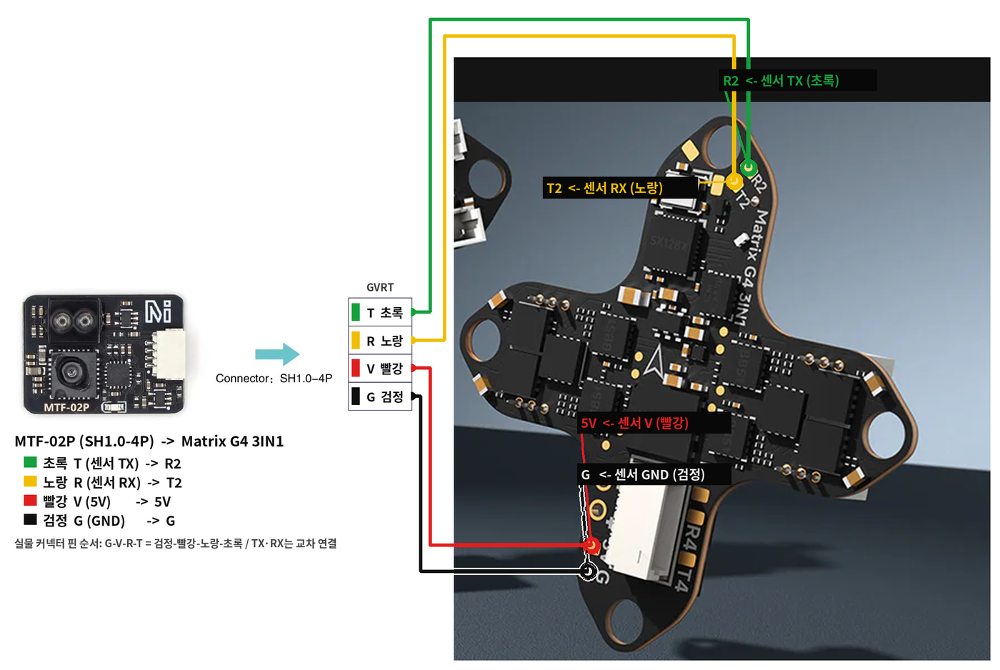
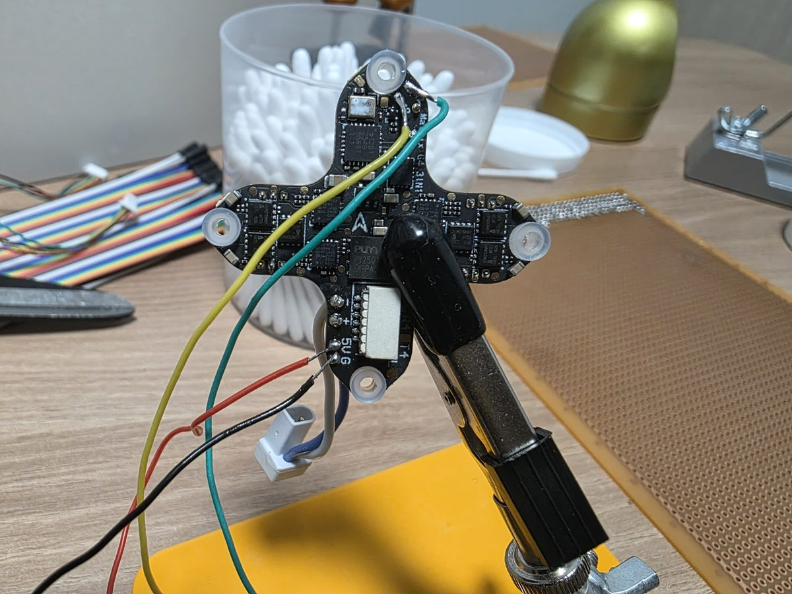
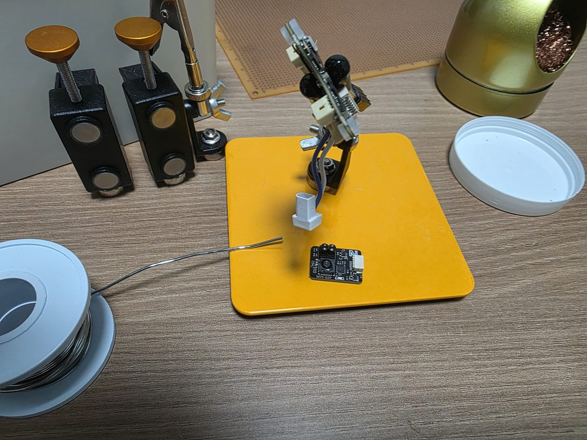

# MTF-02P 하방 센서 (옵티컬 플로우 + 레인지파인더) — Meteor75 Pro 2

MicoAir **MTF-02P**(옵티컬 플로우 + ToF 거리)를 Meteor75 Pro 2의 FC(BETAFPV Matrix G4 3IN1,
타깃 `BETAFPVG473`)에 연결하고, Betaflight가 센서 값을 읽도록 설정한 기록이다.
목적은 **Betaflight를 이너 루프로 유지한 채 센서 값을 MSP로 PC에 가져오는 것**이며,
고도·위치 제어 로직은 BuddyBox(PC) 쪽에서 직접 작성한다.

```
MTF-02P ──UART2(MSP, 115200)──▶ Betaflight FC ──MSP──▶ PC (BuddyBox)
                                 (rangefinder/opticalflow 처리)
```

> **진행 상황 (2026-10-11)**: 납땜·센서 설정·Betaflight 2026.6.2 인식 완료.
> Sensors 탭 Sonar 그래프(거리)와 Debug 그래프(플로우) 수신 확인.
> 남은 일: 기체 하단 장착 + 플로우 방향 보정, PC 쪽 MSP 판독 코드.

## 1. 배선



센서 커넥터(SH1.0-4P) 실크 순서는 **G-V-R-T**, 동봉 케이블 색은 **검정-빨강-노랑-초록**이다.
TX/RX는 교차 연결한다.

| 선 색 | 센서 핀 | FC 패드 |
|---|---|---|
| 검정 | G (GND) | **G** |
| 빨강 | V (5V) | **5V** |
| 노랑 | R (센서 RX) | **T2** |
| 초록 | T (센서 TX) | **R2** |





- 저가 케이블은 색 배열이 뒤집혀 오는 경우가 있으니, 납땜 전 센서 GND 패드와 검정선 도통을 확인한다.
- TX/RX를 바꿔 꽂아도 손상은 없다(데이터만 안 들어옴). **5V/GND 역결선은 센서 손상 위험.**
- 플럭스는 인두를 담그지 말고 패드·선에 직접 바른다. 작업 후 IPA로 잔여물 제거(R2/T2 신호 패드 주변).
- 센서 파란 LED = 전원 정상. LED만으로는 데이터선 연결 여부를 알 수 없다.

## 2. 센서 출력 프로토콜을 MSP로 변경 (MicoAssistant)

MicoAir 센서는 출고 시 자체 프로토콜(MicoLink)로 출력하므로 **MSP로 바꿔야** Betaflight가 해석한다.
센서를 떼지 않고 FC를 USB-UART 브리지로 써서 설정한다.

1. 배터리 연결(USB만으로는 5V 패드에 전원이 안 들어갈 수 있음)
2. Betaflight CLI:
   ```
   serialpassthrough UART2 115200
   ```
   `Forwarding, power cycle to exit.`가 나와야 성공.
   **이 버전은 포트를 번호가 아닌 이름으로 받는다** — `serialpassthrough 1 115200`은 `Invalid port`.
3. Betaflight App(브라우저)을 **완전히 종료** — 포트를 잡고 있으면 `Failed to open serial port`
4. [MicoAssistant](https://micoair.com/assistant/) (Windows, .NET Framework 4.7.2 필요) → 같은 COM 포트, 115200 접속
5. Data 메뉴에서 거리값 변화 확인 → Params에서 **Protocol = MSP** 저장
6. 배터리·USB 모두 분리 후 재연결 → passthrough 해제 (설정을 저장하는 명령이 아니라서 복구할 것 없음)

> 실전 이슈: MicoAssistant Log에 `###ERROR IN input: UNKNOWN COMMAND, TRY 'HELP'###`(hex)가
> 반복되면 passthrough가 걸리지 않은 상태다. MicoAssistant의 식별 요청에 Betaflight CLI가 대답하고 있는 것.

`serialpassthrough`는 FC가 USB↔UART2 바이트를 해석 없이 그대로 넘기게 하는 임시 모드다.
지상 설정·디버깅용이며 비행 중에는 쓸 수 없다(FC가 센서를 읽지 않음).

## 3. Betaflight 펌웨어 — 2026.6.2 필요

**2025.12.x에서는 MTF 센서가 인식되지 않는다.** 빌드 옵션에서 Range Finder / Optical Flow를 켜도
MicoAir용 드라이버(`USE_RANGEFINDER_MT`, `USE_OPTICALFLOW_MT`)가 자동 포함되지 않기 때문이다.

| 증상 (2025.12.5) | 원인 |
|---|---|
| `rangefinder_hardware`에 `MTF02P`가 목록에 보이고 설정도 저장됨 | 이름 목록은 드라이버 포함 여부와 무관하게 표시 |
| `tasks`에 RANGEFINDER/OPTICALFLOW 없음, Sonar 토글 비활성 | 감지 함수가 컴파일되지 않아 센서 미감지 |

- 소스 비교: [common_post.h @ 2025.12.5](https://github.com/betaflight/betaflight/blob/2025.12.5/src/main/target/common_post.h) vs
  [@ 2026.6.2](https://github.com/betaflight/betaflight/blob/2026.6.2/src/main/target/common_post.h)
- 동일 증상 이슈: [betaflight-configurator #5058](https://github.com/betaflight/betaflight-configurator/issues/5058)
- 2025.12.x를 꼭 써야 하면 Expert Mode → Custom Defines에 `USE_RANGEFINDER_MT USE_OPTICALFLOW_MT`

### 빌드 설정 (Firmware Flasher)

| 항목 | 값 |
|---|---|
| Board | `BETAFPVG473` |
| Version | **2026.6.2** (정식) |
| Radio Protocol | CRSF (내장 ELRS) |
| OSD Protocol | Digital (Walksnail, MSP DisplayPort) |
| Motor Protocol | DSHOT |
| Other Options | LED Strip, VTX, **Range Finder, Optical Flow**, Position Hold(선택) |

- Firmware Flasher 탭은 FC **연결 해제 상태**에서만 보인다.
- `Initiating reboot to bootloader`에서 멈추면: 브라우저 사이트 권한에 `DFU in FS Mode`가 있으면
  FC는 이미 DFU 진입 상태 → **페이지 새로고침 후 다시 Flash**. 권한 ✕는 누르지 말 것.
- 플래싱하면 설정이 공장 기본값으로 초기화된다(ARM 스위치 `aux`, `align_board_yaw = -90`, PID 등 소실).
  반드시 백업 → 복구한다. Betaflight App이 플래싱 직전 `BTFL_cli_backup_*.txt`를 자동 저장한다.
- 복구 전 `The accelerometer is enabled but it is not calibrated` 경고는 정상(복구 파일에 `acc_calibration` 포함).

## 4. 설정

복구 파일: [configs/betaflight/meteor75_2026.6.2_restore.txt](../configs/betaflight/meteor75_2026.6.2_restore.txt)
(원본 백업: [meteor75_2025.12.5-alpha_backup.txt](../configs/betaflight/meteor75_2025.12.5-alpha_backup.txt))

CLI에 파일 전체를 붙여 넣으면 `save`까지 실행된다. 원본 대비 추가된 내용:

```
serial UART2 1 115200 57600 0 115200   # UART2 기능 0(미사용) → 1(MSP)
feature RANGEFINDER
feature OPTICALFLOW
set rangefinder_hardware = MTF02P
set opticalflow_hardware = MT
set debug_mode = OPTICALFLOW
batch end
```

**`feature RANGEFINDER/OPTICALFLOW`가 없으면** 하드웨어를 지정해도 작업(task)이 시작되지 않는다
([tasks.c](https://github.com/betaflight/betaflight/blob/2026.6.2/src/main/fc/tasks.c) — 센서 감지 + feature 둘 다 필요).

`serial` 기능값은 비트 합: 1 = MSP, 64 = Serial RX, 131072 = MSP DisplayPort.

| UART | 기능값 | 용도 |
|---|---|---|
| UART2 | 1 | MTF-02P (MSP) |
| UART3 | 64 | 내장 ELRS (CRSF) — 보드 기본값이라 diff에 안 나옴 |
| UART4 | 131073 | Walksnail HD VTX (MSP + DisplayPort) |

## 5. 동작 확인

1. 배터리 연결 상태에서 CLI `tasks` → **RANGEFINDER, OPTICALFLOW** 작업이 목록에 있어야 함
2. Sensors 탭 → **Sonar** 토글 활성화 → 센서 앞에서 손을 움직이면 거리 그래프 변화
3. **Debug** 토글 → 무늬 있는 바닥 위 10cm 이상에서 기체를 움직이면 플로우 값 변화

- **Sonar** = 레인지파인더(바닥까지 거리). 최초 지원 센서가 초음파(HC-SR04)라 이름만 남은 것.
  그래프 값은 `MSP_SONAR_ALTITUDE`로 받은 **기울기 보정 고도(cm)**. 범위 밖·과도한 기울기는 음수.
- 옵티컬 플로우는 Configurator에 전용 그래프가 없다(Live Sensor Data: Gyro/Accel/Mag/Altitude/Sonar/Pitot/Debug뿐 —
  [LiveSensorPanel.vue](https://github.com/betaflight/betaflight-configurator/blob/master/src/components/tabs/sensors/LiveSensorPanel.vue)).
  `debug_mode = OPTICALFLOW`로 Debug 그래프에서 본다.
- Debug 채널은 한 모드만 선택 가능. 레인지파인더 원시값을 보려면 `debug_mode = RANGEFINDER`(debug[1] 원시, debug[2] 보정).

### OPTICALFLOW 디버그 채널 (단위 0.001 rad/s)

| 채널 | 내용 |
|---|---|
| debug[0], [1] | 회전 보정된 플로우 X, Y |
| debug[2], [3] | 자이로 보상값 (기체 회전 성분) |
| debug[4], [5] | 회전 성분 제거 플로우 X, Y (무효 시 0) |
| debug[6], [7] | 필터링된 최종 플로우 X, Y |

- 플로우는 **거리 80mm 이상 + 최신 거리값**일 때만 유효 처리된다
  ([rangefinder_lidarmt.c](https://github.com/betaflight/betaflight/blob/master/src/main/drivers/rangefinder/rangefinder_lidarmt.c)).
- 조도 60 lux 이상, 단색이 아닌 무늬 있는 바닥이 필요하다.

## 6. 장착과 방향 (예정)

- 렌즈 면이 **바닥과 평행하게 정면으로** 향하도록, 가능하면 기체 중앙(무게중심 근처)에 장착
- 다리(랜딩기어)가 시야각 42° 원뿔 안에 들어오지 않게 한다. 덕트 장착형이 유리
  - [Meteor75 Pro Landing Gears](https://makerworld.com/models/1339408-meteor75-pro-landing-gears) (약 12mm, PLA/TPU)
  - [Meteor 75 Pro Landing Gear TPU](https://makerworld.com/en/models/1373764-betafpv-meteor-75-pro-landing-gear-tpu) (10mm, 약 4.1g)
  - 둘 다 "Meteor75 Pro" 기준 — Pro 2 덕트 호환은 확인 필요
- 센서 뒷면 금속 접점은 테이프로 절연
- 앞뒤 방향은 아무렇게나 붙여도 설정으로 보정 가능 ([#15711](https://github.com/betaflight/betaflight/issues/15711) 방법):
  1. 기체를 **앞으로 밀 때 debug[7]이 증가**해야 함 → 아니면 `opticalflow_rotation` 90/180/270
  2. 좌우로 밀 때 debug[6] 부호가 반대면 `opticalflow_flip_x = ON`
  3. MicoAssistant의 Flow Direction은 **NONE 유지** (양쪽에서 돌리면 이중 회전)

## 7. PC에서 값 읽기 (BuddyBox)

| 데이터 | MSP 명령 | 페이로드 |
|---|---|---|
| 거리(고도) | `MSP_SONAR_ALTITUDE` (58) | int32, cm, 기울기 보정. 음수 = 범위 밖/측정 실패 |
| 플로우 | `MSP_DEBUG` (254) | int16 × 8 (`debug_mode = OPTICALFLOW`일 때 위 표) |

- 제어 입력으로는 debug[4]/[5] 또는 [6]/[7] (회전 성분 제거된 실제 이동 흐름)
- 2026.6의 `MSP2_CLI_SETTING`(0x3010, 2026.6.2 `msp_protocol_v2_betaflight.h` 기준)으로 PC에서 CLI 설정값을 직접 읽고 쓸 수 있다.
- **벤치**: USB 연결로 바로 판독 가능 → 판독 코드 작성 완료 (아래)

### 구현 (python/)

| 모듈 | 역할 |
|---|---|
| `buddybox/msp.py` | `MspSerial`(USB-VCP) · `MspClient`(SITL TCP) 공용 API — `sonar_altitude_m()`, `debug()`, `attitude()`, `altitude()`. `open_msp("COM7" / "sitl")` |
| `buddybox/follow/sensors.py` | `SensorPoller`: 백그라운드 폴링(기본 20 Hz) → `RangeFlowSample(alt_m, flow_x/y rad/s, vx/vy m/s)`. 속도 = 플로우 × 고도 |
| `buddybox/follow/hover.py` | `HoverHold`: 고도 PID(목표 m → 스로틀 Δ) + 위치 유지(속도 Kv + 드리프트 적분 Kp → roll/pitch) |
| `tools/mtf02p_monitor.py` | 벤치 모니터. `python tools/mtf02p_monitor.py COM7 --check` 로 장착 방향 확인 |

```
python tools/mtf02p_monitor.py COM7 --hz 20 --raw        # 거리·플로우 실시간
python examples/person_follow.py --port COM5 --msp COM7  # Pro Micro + FC USB (벤치, 프롭 제거)
```

`--msp COMx`를 주면 ARM 확인(MSP_STATUS)과 센서 폴링이 같은 포트를 공유한다.
설정 `alt_hold`·`pos_hold`를 켜면 HOVER/LOST/FOLLOW에서 센서 홀드가 동작하고, 센서가 없거나
무효(범위 밖·0.4 s 이상 지연)이면 자동으로 기존 개루프 트림으로 돌아간다 — [person-follow.md](person-follow.md#하방-센서-홀드-mtf-02p) 참고.
- **비행 중**: 현재 체인(PC → Pro Micro PPM → TX15 → ELRS)은 업링크만 있다. 후보 다운링크:

| 경로 | 비고 |
|---|---|
| ELRS 텔레메트리 + MSP 요청 → TX15 USB → PC | 추가 하드웨어 없음. 대역폭 작음. TX15 USB 시리얼 모드/Lua 중계 확인 필요 |
| Walksnail 영상 링크 | MSP는 OSD 표시용일 뿐 원시 값 출력 없음 → 부적합 |
| ESP32-C3 등 별도 무선 | 가장 직접적이나 75mm 1S에는 무게·전력 부담 |

- 왕복 지연이 길므로 **빠른 안정화는 FC, PC는 목표·상위 판단·로깅**으로 분리한다.

## 8. 참고: 2026.6 업그레이드에서 바뀐 점 (이 기체 기준)

- 비행: Airmode LPF 제거, D-term 기본값 조정(`d_max_advance` 0), `thrust_linear` 곡선 재계산, 필터 Biquad→SVF.
  큰 재튜닝은 불필요하지만 첫 비행은 짧은 호버링으로 확인.
- 시리얼 CRSF·HD OSD 동작 변화 없음. CRSF 텔레메트리에 AHRS·기압 고도·수직 속도 추가.
- 백업의 `set` 항목 이름은 2026.6.2 소스에 전부 존재(복구 에러 없음 확인).
- Betaflight 자체 위치 유지(칼만 필터 위치 추정, [PR #15584](https://github.com/betaflight/betaflight/pull/15584))는
  master(2026.12 예정)에 병합 — 2026.6.2에는 미포함. BuddyBox는 자체 제어를 쓰므로 무관.

출처: [Betaflight 2026.6 Release Notes](https://betaflight.com/docs/wiki/release/Betaflight-2026-6-Release-Notes)
